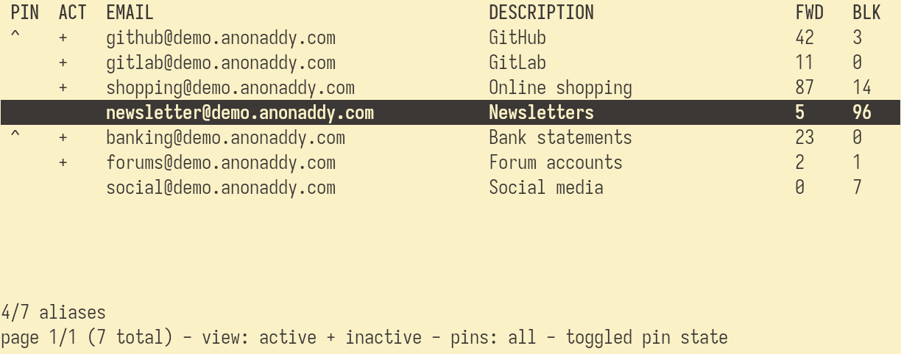

# addyui

[addy.io][addy_api] terminal user interface.

# PREVIEW



# INSTALL

Download from [release artifacts][release_artifacts] or build from source:

```sh
git clone https://github.com/kovmir/addyui.git
cd addyui
make build install
```

# USAGE

[Create a new addy.io token][addy_api], and set `ADDY_API_KEY=your_token`.
Invoke `addyui -help` to see the available CLI flags. Invoke `addyui` to start
the program. Hit `F1` for help in the TUI.

[addy_api]: https://app.addy.io/settings/api
[addy_homepage]: https://addy.io/
[release_artifacts]: https://github.com/kovmir/addyui/releases/latest
